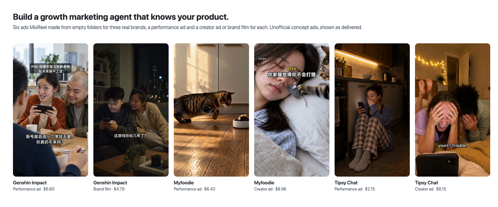
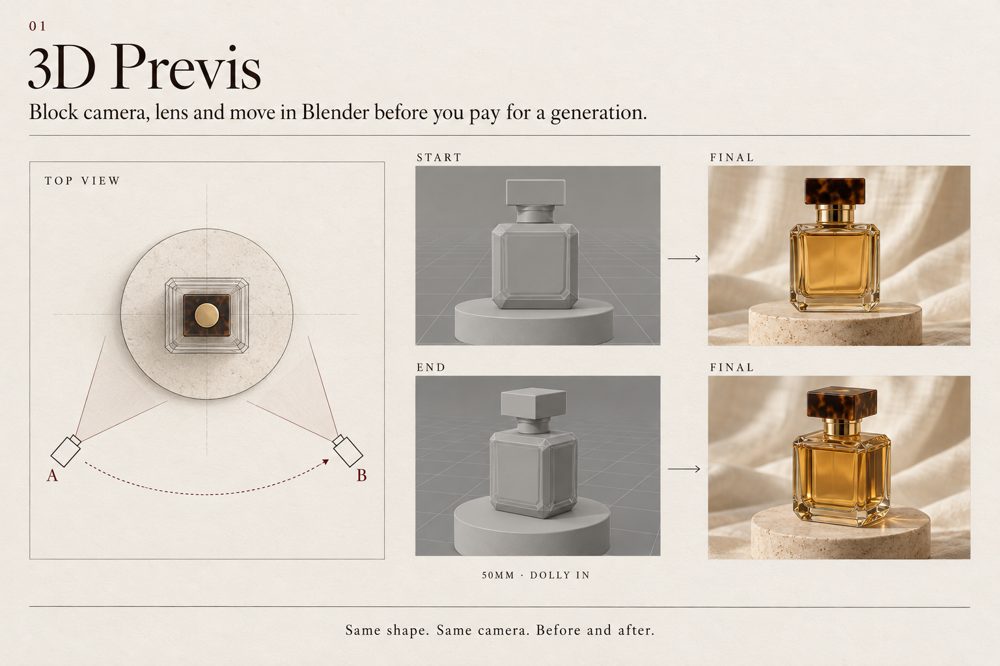
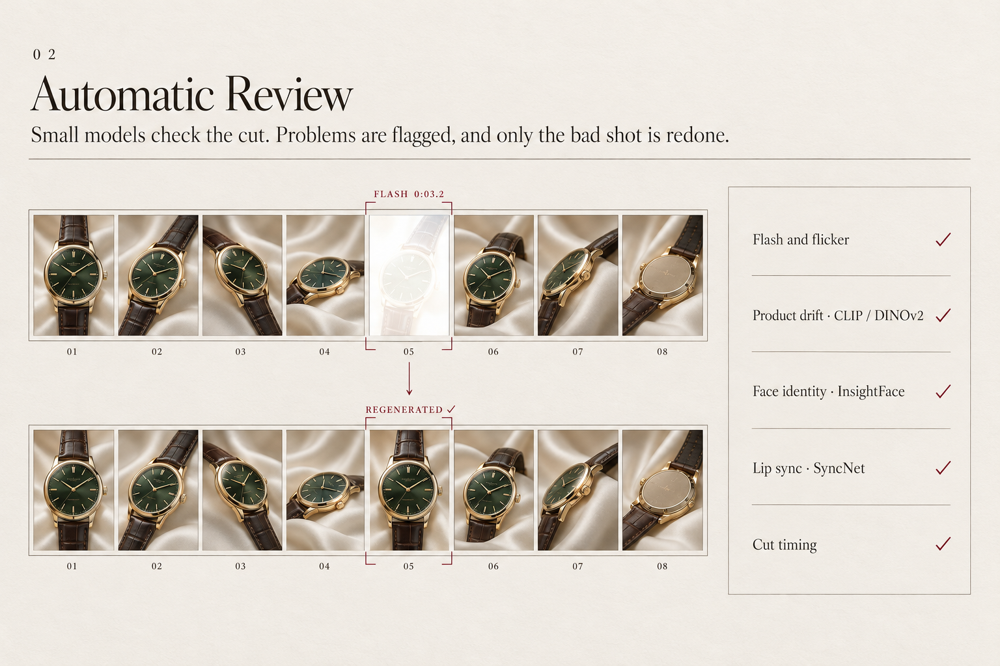
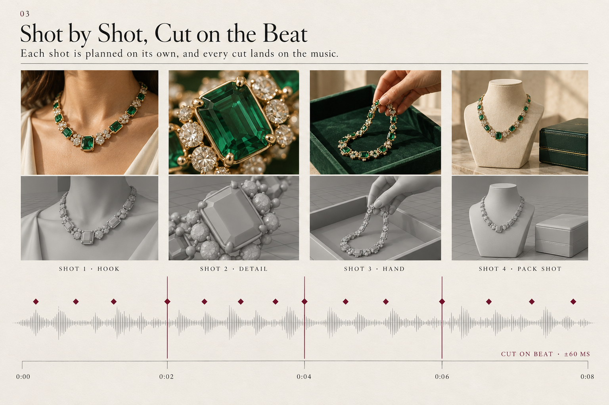
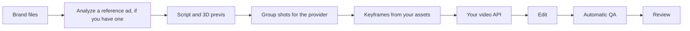

# MixReel

Block the shot in 3D before you pay for a generation. Then let the cut tell you when a frame flashed, a cut landed late, or the package stopped matching the real product.

MixReel is a truly open-source agent skill for **ad, e-commerce, and product short videos**. It runs locally. You bring the model, on that vendor's own API, with your own key. This repository does not host a relay and does not lock you to one model.

[](https://github.com/MobAI-Inc/MixReel/actions/workflows/ci.yml)
[](LICENSE)

<p align="center">
  
</p>

Coming soon. Finished films will land in the demo slots below. The quickstart still runs with no API key.

## Four things MixReel does

<table>
<tr>
<td width="50%" valign="top">

<p><b>1. 3D previs before you pay.</b> Block the camera, lens, and move in Blender (or the built-in Python fallback) first. The product shape and the camera angle stay the same from the grey plan to the finished frame.</p>
</td>
<td width="50%" valign="top">

<p><b>2. Automatic review on the cut.</b> The checker finds flashes, flicker, late or missed cuts, and stray frames. Optional small models add product drift (CLIP, DINOv2), face identity (InsightFace), and lip sync (SyncNet). Problems get a timecode, and only the bad shot is regenerated.</p>
</td>
</tr>
<tr>
<td width="50%" valign="top">

<p><b>3. Shot by shot, cut on the beat.</b> The script is split into shots and generation groups, each with its own timing and keyframes. <code>beat_grid.py</code> finds the beats in your track, and QA flags any cut more than 60 ms off the beat (the default tolerance).</p>
</td>
<td width="50%" valign="top">

<p><b>4. Any model, fully open.</b> One small provider interface. Example adapters call the official MiniMax and Seedance APIs with your own key, and you can add your own. Gemini review is optional. Every line of the source is in this repository.</p>
</td>
</tr>
</table>

## Quickstart

No API key. Python 3.10+, `ffmpeg`, `ffprobe`, and the packages in `requirements.txt`.

```sh
git clone https://github.com/MobAI-Inc/MixReel.git
cd MixReel
python3 -m pip install -r requirements.txt
python3 scripts/demo.py
```

The command writes a temporary directory and prints its path. Inside it:

- a rough previs of a bottle orbit (`previs/plan.png`, start and end stills)
- a 4-second edit made from synthetic clips (`master.mp4`)
- `qa.json` for that edit
- the checker's own synthetic self-check, which must catch a white flash, a black flash, flicker, a late cut, and an off-beat cut

Nothing is downloaded. Nothing is written into the clone. Delete the temp directory when you are done.

Install the skills into an agent skills directory when you want the full pipeline:

```sh
python3 scripts/install.py --destination ~/.agents/skills
```

The installer copies seven skills, refuses to overwrite a directory that already exists, and does not read keys. The destination has to be a folder your agent reads skills from. A folder named `skills/` in your project does not count.

| Agent | One project | Every project |
| --- | --- | --- |
| Claude Code | `/path/to/your-project/.claude/skills` | `~/.claude/skills` |
| Codex | Check your version's docs | `~/.codex/skills` |

Give a full path. A relative one would land inside this clone. If the agent does not list the `mixreel` skills afterwards, start a new session in that folder.

## Pipeline



Open your agent in the folder where you want the work kept, and ask for what you need. You can stop after any step.

- `Use mixreel to build brand files for my app`
- `Write a 20-second script`

The `mixreel` skill routes the agent to one stage at a time. Stages can also be invoked on their own. Neither request needs an API key.

## What you can do with it

**Blender previs, before you spend.** Block a product orbit, a hand entering frame, or a multi-angle pack shot in 3D. You get a top view, start and end frames, and a storyboard. Blender is used when it is installed. Without it, a pure Python raster backend still shows occlusion and screen direction. It does not download Blender for you.

**QA on the cut, not on a contact sheet.** `qa_check.py` measures white and black flashes, flicker, cut offset, missed cuts, off-beat cuts, stray frames from the neighboring shot, silence, loudness, peak, and frame size. `frame_pack.py` lays out the stills an agent has to actually look at: overviews, seams, suspect bursts, curves, and full-resolution brand frames.

**Small models, only if you want them.** CLIP and DINOv2 can flag picture and product drift. InsightFace with the small `buffalo_s` pack can check face consistency. SyncNet can report a lip-sync offset. None of these are installed or downloaded by a normal run. Face and lip-sync weights are research-licensed. Read [model weights](docs/model-weights.md) before you turn them on. A public copy of `syncnet_v2.model` is in the `auxiliary/` files of [ByteDance/LatentSync-1.6](https://huggingface.co/ByteDance/LatentSync-1.6).

**Gemini is a hint.** If you set a Gemini key and ask for the pass, the script sends suspect ranges and returns notes. Those notes do not pass or fail the cut.

**A budget journal.** Reserve the worst case before a paid call, store the task id before you do anything else, and reconcile the bill separately from the download. A retry after a lost response looks the old task up. It does not submit a second one. `keyframe_diff.py` catches an edit you paid for that did not change the pixels.

**Your model, your account.** The provider interface is `capabilities`, `submit`, `status`, and `download`. Example adapters call the official MiniMax video API and the official Seedance API on Volcengine Ark or BytePlus. Keys come from your environment. Model ids come from your config. See [providers](docs/providers.md).

**Real marks.** Logos, packaging text, product copy, and app UI are composited from the asset you supply. The skills do not ask a model to invent them.

## Demos

The films are not in the repository yet. The slots are.

| Slot | What it will show | Now |
| --- | --- | --- |
| [Product hero](examples/product-hero/README.md) | Previs, pack shot, QA | Coming soon |
| [App promo](examples/app-promo/README.md) | A real screen recording, captions, music hits | Coming soon |
| [Hook variants](examples/hook-variants/README.md) | One body, three openings | Coming soon |
| [Quickstart](examples/quickstart/README.md) | The no-key command above | Runs today |
| [Demo index](docs/demos/README.md) | Where to drop files | Coming soon |

## QA, in one table

| Check | What it means | A common false alarm |
| --- | --- | --- |
| Flash | A frame is far brighter or darker than its neighbors, then the picture returns | A intentional strobe or a hard white title hit |
| Flicker | Luma alternates up and down across several frames | Fine texture on a fast pan |
| Cut offset | The picture changes later or earlier than the plan | A dissolve you planned as a cut |
| Missed cut | The plan has a cut and the picture does not change | A locked-off shot that was supposed to cut to a similar frame |
| Off-beat cut | The measured cut is outside the beat tolerance | A track with no clear pulse, or a tolerance that is tighter than the edit |
| Stray frames | A few frames of the previous shot survive the cut | Very short intentional flash frames |
| Silence, loudness, peak | The soundtrack is missing, quiet, or hot against the levels you pass in | A deliberate mute |
| Frame size | The master does not match `--size` | A plan that was authored for another aspect |

Suspects are places to look. The review skill still requires someone to watch the images.

## Documentation

- [Getting started](docs/getting-started.md)
- [Providers](docs/providers.md)
- [Previs](docs/previs.md)
- [QA](docs/qa.md)
- [Model weights](docs/model-weights.md)
- [Architecture](docs/architecture.md)
- [FAQ](docs/faq.md)
- [中文说明](README.zh-CN.md)

## License

MixReel is truly open source. Individuals and teams are free to use and modify it. Companies may use it internally and make videos for their clients. Offering it as a hosted, SaaS, or multi-tenant service is not allowed, and selling the software is not allowed. Generated videos belong to the user and can be used commercially. Other commercial licensing: vito_zhong@mobai-game.com. The full terms are in the [MixReel License](LICENSE).

Some local tools include material first published under the MIT license by MixReel contributors. That notice is in [THIRD_PARTY_NOTICES](THIRD_PARTY_NOTICES.md).

## Contributing

See [CONTRIBUTING](CONTRIBUTING.md). By sending a patch you grant MobAI Inc the rights described there, including the right to relicense the contribution and to use it in commercial products.
