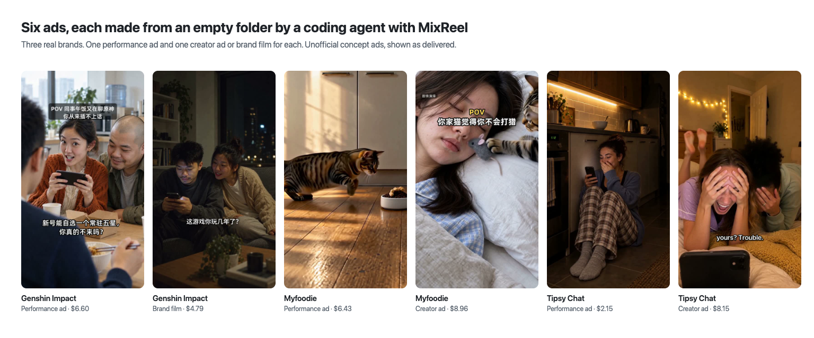
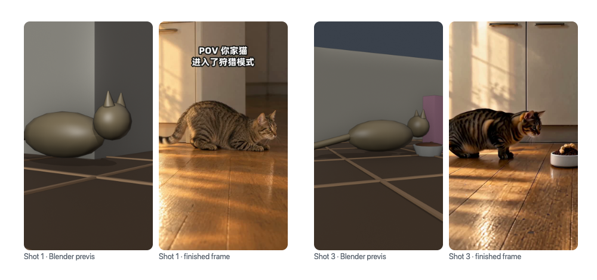
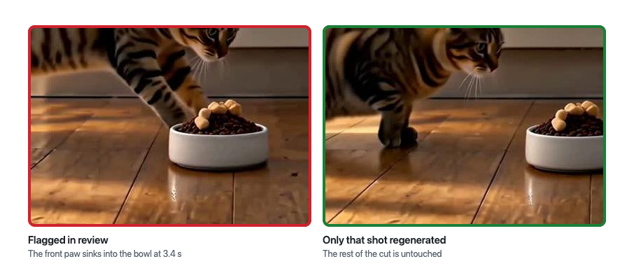
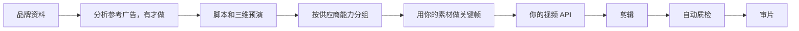

# MixReel

<p align="center"><a href="#案例"><b>案例</b></a> &nbsp;&bull;&nbsp; <a href="#快速开始"><b>快速开始</b></a> &nbsp;&bull;&nbsp; <a href="docs/getting-started.md"><b>入门说明</b></a> &nbsp;&bull;&nbsp; <a href="README.md"><b>English</b></a></p>

先在三维里把镜头摆对，再花钱生成。成片自己会标出闪帧、切晚了的剪辑点，以及包装和真实商品对不上的地方。

MixReel 是开源项目：面向**广告、电商和产品短视频**的 agent skill。它在你的机器上运行。模型用你自己的账号，走该厂商的官方 API。这个仓库不提供中转，也不把你绑在某一个模型上。

[](https://github.com/MobAI-Inc/MixReel/actions/workflows/ci.yml)
[](LICENSE)

<p align="center">
  
</p>

## 案例

三个真实品牌，六条广告，每条都是 coding agent 用 MixReel 从一个空文件夹做出来的。每个品牌各做一条竞价素材，再做一条达人素材或品牌片，同一个产品讲成两种片子。成片按 agent 交付时的样子放出，没有人手动剪辑或修图，小瑕疵也留着。

### 原神 · 抖音，中文

[脚本、分镜和制作说明（英文）](examples/showcase/genshin-impact/README.md)

<table>
  <tr>
    <th width="50%">竞价素材</th>
    <th width="50%">品牌片</th>
  </tr>
  <tr>
    <td><video src="https://github.com/user-attachments/assets/305adf51-c6b3-4712-ae3f-545e185dd965" controls muted></video></td>
    <td><video src="https://github.com/user-attachments/assets/47e622dd-d435-4dc1-9788-195833cc6333" controls muted></video></td>
  </tr>
  <tr>
    <td valign="top"><p><b>「插上话了」</b>，37 秒。午饭时同事又劝闷头吃饭的那位入坑，说 7.2 新号能自选一名常驻五星。两个老玩家凑着看剧情片段，他突然接上了那句台词，原来他早就偷偷入坑了。</p><p>新手福利照抄官网公告原文，手机里那句台词取自官方 7.2 PV，核对过是谁说的。</p><p>生成费用 <b>6.60 美元</b></p></td>
    <td valign="top"><p><b>「这一桌人」</b>，44 秒。7.2 更新那晚，玩了六年的男生看主线红了眼。女朋友问他不腻吗，他把手机转过去，屏幕上是七国代表围坐的圆桌，他说这一桌人是他这六年一个一个认识的。</p><p>画面用的是官方 PV 片段和官方美术图，游戏角色一律不让模型画。</p><p>生成费用 <b>4.79 美元</b></p></td>
  </tr>
</table>

### 麦富迪猫粮 · 抖音，中文

[脚本、分镜和制作说明（英文）](examples/showcase/myfoodie/README.md)

<table>
  <tr>
    <th width="50%">竞价素材</th>
    <th width="50%">达人素材</th>
  </tr>
  <tr>
    <td><video src="https://github.com/user-attachments/assets/ea549b62-cab7-4150-b72c-fe26b10e4085" controls muted></video></td>
    <td><video src="https://github.com/user-attachments/assets/2be40599-ab40-4324-a337-3f1347ffd823" controls muted></video></td>
  </tr>
  <tr>
    <td valign="top"><p><b>「狩猎模式」</b>，19 秒。狸花猫把饭碗当猎物，伏低、扭屁股、扑上去。第 6 秒左右出优惠卡，唯一的卖点是包装上印着的「≥80% 肉/骨/内脏」。</p><p>包装是官方原图合成进画面，包装上的字逐个对过原图。</p><p>生成费用 <b>6.43 美元</b></p></td>
    <td valign="top"><p><b>「她会打猎了」</b>，53 秒。猫认定主人不会打猎，天天往她枕边放玩具老鼠。这天她抱回一个箱子，猫验货，一字一字念出「肉。骨。内脏。」，认了她。夜里它还是又放了一只老鼠，保险起见。</p><p>用的是同一张官方包装图，两条片子用的是同一只猫。</p><p>生成费用 <b>8.96 美元</b></p></td>
  </tr>
</table>

### Tipsy Chat · Meta，英文

[脚本、分镜和制作说明（英文）](examples/showcase/tipsy-chat/README.md)

<table>
  <tr>
    <th width="50%">竞价素材</th>
    <th width="50%">达人素材</th>
  </tr>
  <tr>
    <td><video src="https://github.com/user-attachments/assets/af948568-ab5f-43c5-a32d-55706ea14d9d" controls muted></video></td>
    <td><video src="https://github.com/user-attachments/assets/2c0918ce-b603-4401-a200-45f17e74e711" controls muted></video></td>
  </tr>
  <tr>
    <td valign="top"><p><b>「Ch 47 coming soon」</b>，23 秒。凌晨一点，她又刷新了一篇 2021 年就停更的同人文。她打开 Tipsy 自己往下写，故事回了她下一段。</p><p>界面取自 Tipsy 自家广告里的真实画面，隐私文字打了码。</p><p>生成费用 <b>2.15 美元</b></p></td>
    <td valign="top"><p><b>「Who is Biscuit」</b>，41 秒。她以为室友藏了个男朋友，推门才发现是 Tipsy 里西部故事的牛仔在打电话。到最后她自己也趴到床上，问自己那匹马叫什么。</p><p>通话界面是 Tipsy 的真实画面，所有台词都由视频模型说出来。</p><p>生成费用 <b>8.15 美元</b></p></td>
  </tr>
</table>

**怎么做的。** 每个品牌都是 agent 先从公开资料建好品牌文件，再从品牌自己的卖点写脚本。多镜头的场景先在 Blender 里排好机位。真人的脸用 Midjourney 生成，再交给 GPT Image 补全。镜头和台词由 MiniMax H3 生成，大部分用的是 1080p 的 H3 Max Turbo。logo、包装和 App 界面用真实素材合成，成片过一遍 MixReel 的自动审片，再让 Gemini 听一遍声音。六条成片的生成费用一共 37.08 美元。

以上都是为展示工作流制作的非官方概念片，与米哈游、麦富迪、Tipsy Chat 没有合作，也未获授权。角色、商标、包装和 App 界面归各自权利人所有，不在本仓库的许可证范围内。

## 四个特色

<table>
<tr>
<td width="50%" valign="top">

<p><b>1. 先三维预演，再花钱生成。</b>机位、焦段和运镜先在 Blender（或内置的纯 Python 后端）里摆好。从灰模到成片，产品形状和机位都对得上。</p>
</td>
<td width="50%" valign="top">

<p><b>2. 成片自动审片。</b>自动查闪帧、闪烁、切晚或漏切、邻镜残帧。可选的小模型再查产品漂移（CLIP、DINOv2）、人脸是不是同一个人（InsightFace）、口型对不对（SyncNet）。有问题会标出时间码，只重做那一个镜头。</p>
</td>
</tr>
<tr>
<td width="50%" valign="top">
<p><b>3. 按镜头拆细，剪辑卡点。</b>脚本拆成一个个镜头和生成分组，各自有时长和关键帧。<code>beat_grid.py</code> 从音乐里找出节拍，切点偏离节拍超过 60 毫秒（默认容差）就会被标出来。</p>
</td>
<td width="50%" valign="top">
<p><b>4. 不绑模型，源码全开。</b>一个很小的供应商接口。示例适配器用你自己的密钥调用 MiniMax 和 Seedance 的官方 API，你也可以接自己的模型。Gemini 审片可选。所有源码都在这个仓库里。</p>
</td>
</tr>
</table>

## 快速开始

不需要 API 密钥。需要 Python 3.10+、`ffmpeg`、`ffprobe`，以及 `requirements.txt` 里的包。

```sh
git clone https://github.com/MobAI-Inc/MixReel.git
cd MixReel
python3 -m pip install -r requirements.txt
python3 scripts/demo.py
```

命令会在临时目录里写出：

- 一只瓶子的环绕预演（俯视图、每镜首尾帧）
- 用合成画面剪成的 4 秒成片 `master.mp4`
- 这份成片的 `qa.json`
- 质检器的自检：必须抓住白闪、黑闪、闪烁、切点偏移和不卡拍

它不下载文件，也不往仓库里写媒体。看完可以删掉打印出来的临时目录。

把七个 skill 装进 agent 的技能目录，按你用的 agent 选一行：

```sh
# Claude Code，所有项目可用
python3 scripts/install.py --destination ~/.claude/skills
# Codex，所有项目可用
python3 scripts/install.py --destination ~/.codex/skills
```

安装器只复制文件，不覆盖已有目录，不读取密钥。目标必须是 agent 读取技能的文件夹，项目里一个叫 `skills/` 的文件夹不算。

| Agent | 只给一个项目 | 给所有项目 |
| --- | --- | --- |
| Claude Code | `/你的项目路径/.claude/skills` | `~/.claude/skills` |
| Codex | 查你所用版本的文档 | `~/.codex/skills` |

要写完整路径，写相对路径会装进这个克隆目录里。装完 agent 列不出 `mixreel` 技能的话，在那个文件夹里开一个新会话。克隆目录别删，`providers/` 里的接口示例不会拷进技能目录。以后升级新版本的做法见[入门说明](docs/getting-started.md#upgrade)。

## 流程



在你想放工作文件的文件夹里打开 agent，直接说要什么，做到哪一步都可以停。

- `用 mixreel 给我的 App 建品牌资料`
- `写一条 20 秒脚本`

`mixreel` 技能一次带 agent 走一个阶段，也可以单独调用其中一步。这两句都不需要 API key。

## 它做哪几件事

**花钱之前先做 Blender 预演。** 产品环绕、手部入画、同一包装的多机位，先在三维里看遮挡和方向。装了 Blender 就用 Blender。没装时，纯 Python 光栅后端仍然能看位置和穿帮，而且不会自行下载 Blender。

**质检打在成片上。** `qa_check.py` 检查闪白、闪黑、闪烁、切点偏移、漏切、不卡拍、邻镜头残帧、静音、响度、峰值和尺寸。`frame_pack.py` 按固定顺序出图：总览、接缝、可疑片段连拍、曲线、品牌全分辨率帧。审片时这些图都要看。

**小模型是可选的。** CLIP 和 DINOv2 用来看画面和产品是否漂了。InsightFace 的小模型 `buffalo_s` 用来看人脸是否还是同一个人。SyncNet 用来看口型偏移。默认不安装、不下载。人脸和口型权重是研究许可，商用前先读[权重说明](docs/model-weights.md)。`syncnet_v2.model` 的一份公开副本在 [ByteDance/LatentSync-1.6](https://huggingface.co/ByteDance/LatentSync-1.6) 的 `auxiliary/` 里。

**Gemini 只提供提示。** 你自己配置密钥并明确要求时，它才会看可疑片段。它的输出不是通过，也不是不通过。

**预算有账。** 付费前预留上限，拿到任务号立刻记账，下载和结算分开。超时之后先查旧任务，不重复提交。`keyframe_diff.py` 会抓住「付了钱但像素没变」的修改。

**模型随你。** 接口是 `capabilities`、`submit`、`status`、`download`。示例适配器分别调用 MiniMax 官方视频 API，以及火山方舟或 BytePlus 上的 Seedance 官方 API。密钥来自你的环境变量，模型名来自你的配置。见[接入说明](docs/providers.md)。

**品牌用真素材。** 标志、包装文字、商品文案和 App 界面用你提供的文件叠上去，不让模型现画。

## 示例位

这些位置用的是虚构品牌，还在补。做好的成片在上面的[案例](#案例)里。

| 位置 | 将来放什么 | 现在 |
| --- | --- | --- |
| [商品主镜](examples/product-hero/README.md) | 预演、主图视频、质检 | 即将推出 |
| [应用推广](examples/app-promo/README.md) | 真实录屏、字幕、卡点 | 即将推出 |
| [多开头](examples/hook-variants/README.md) | 同一中段，三个开头 | 即将推出 |
| [快速体验](examples/quickstart/README.md) | 上面那条无密钥命令 | 现在可跑 |
| [索引](docs/demos/README.md) | 文件该放哪 | 即将推出 |

## 质检一览

| 检查 | 含义 | 常见误报 |
| --- | --- | --- |
| 闪帧 | 某一帧比邻帧亮得多或暗得多，随后画面回到原亮度 | 故意的白场或标题砸点 |
| 闪烁 | 亮度来回跳动 | 快速横摇上的细纹理 |
| 切点偏移 | 画面变化早于或晚于计划 | 计划写成硬切、成片却是叠化 |
| 漏切 | 计划有切点，画面却没变 | 两镜本来就很像 |
| 不卡拍 | 实测切点离节拍超过容差 | 音乐没有稳定重拍，或容差太紧 |
| 残帧 | 上一镜的少数帧留在切点之后 | 故意做的几帧闪白 |
| 静音、响度、峰值 | 声音缺失、过小或过载 | 计划里的静音 |
| 尺寸 | 成片和 `--size` 不一致 | 计划按另一种比例写的 |

可疑点只说明该看哪里。审片技能仍然要求把检查图看完。

## 文档

- [上手](docs/getting-started.md)
- [模型接入](docs/providers.md)
- [预演](docs/previs.md)
- [质检](docs/qa.md)
- [模型权重](docs/model-weights.md)
- [结构](docs/architecture.md)
- [常见问题](docs/faq.md)
- [English](README.md)

## 许可证

MixReel 采用 [Apache License 2.0](LICENSE) 许可。生成的视频归用户所有，可以商用。联系邮箱：vito_zhong@mobai-game.com。

一部分本地工具含有 MixReel contributors 以 MIT 许可首次发布的代码，说明见 [THIRD_PARTY_NOTICES](THIRD_PARTY_NOTICES.md)。

## 贡献

见 [CONTRIBUTING](CONTRIBUTING.md)。贡献依照许可证第 5 节采用 Apache-2.0 许可，与项目对外采用的许可证一致（inbound = outbound）。
