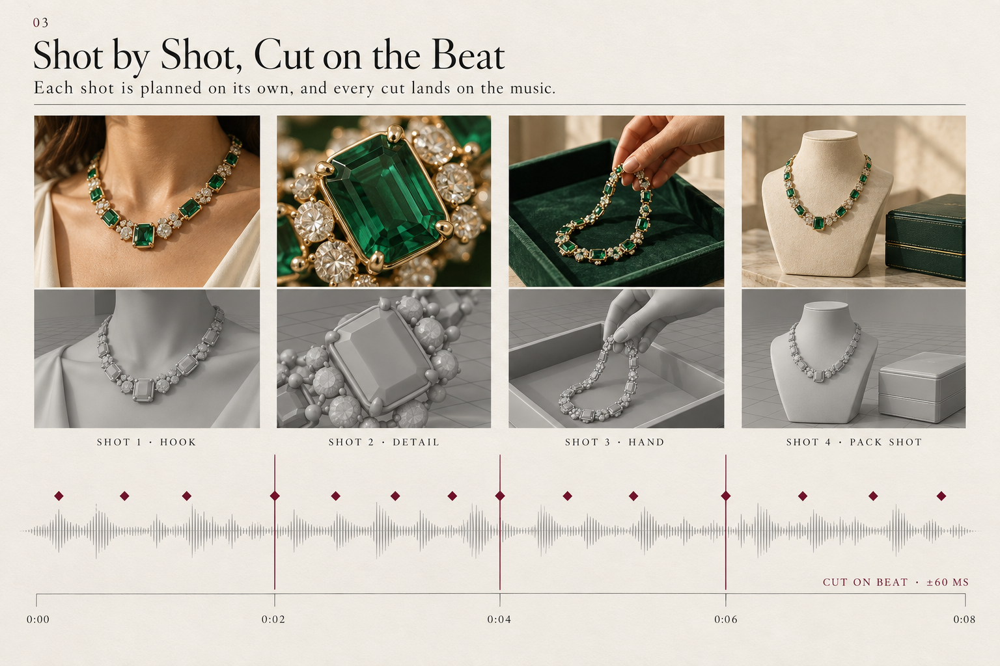
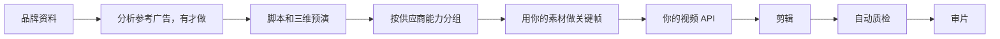

# MixReel

先在三维里把镜头摆对，再花钱生成。成片自己会标出闪帧、切晚了的剪辑点，以及包装和真实商品对不上的地方。

MixReel 是真正开源的项目：面向**广告、电商和产品短视频**的 agent skill。它在你的机器上运行。模型用你自己的账号，走该厂商的官方 API。这个仓库不提供中转，也不把你绑在某一个模型上。

[](https://github.com/MobAI-Inc/MixReel/actions/workflows/ci.yml)
[](LICENSE)

<p align="center">
  
</p>

即将推出。成片会放进下面的案例位。不需要密钥的快速体验现在就能跑。

## 四个特色

<table>
<tr>
<td width="50%" valign="top">

<p><b>1. 先三维预演，再花钱生成。</b>机位、焦段和运镜先在 Blender（或内置的纯 Python 后端）里摆好。从灰模到成片，产品形状和机位都对得上。</p>
</td>
<td width="50%" valign="top">

<p><b>2. 成片自动审片。</b>自动查闪帧、闪烁、切晚或漏切、邻镜残帧。可选的小模型再查产品漂移（CLIP、DINOv2）、人脸是不是同一个人（InsightFace）、口型对不对（SyncNet）。有问题会标出时间码，只重做那一个镜头。</p>
</td>
</tr>
<tr>
<td width="50%" valign="top">

<p><b>3. 按镜头拆细，剪辑卡点。</b>脚本拆成一个个镜头和生成分组，各自有时长和关键帧。<code>beat_grid.py</code> 从音乐里找出节拍，切点偏离节拍超过 60 毫秒（默认容差）就会被标出来。</p>
</td>
<td width="50%" valign="top">

<p><b>4. 不绑模型，源码全开。</b>一个很小的供应商接口。示例适配器用你自己的密钥调用 MiniMax 和 Seedance 的官方 API，你也可以接自己的模型。Gemini 审片可选。所有源码都在这个仓库里。</p>
</td>
</tr>
</table>

## 快速开始

不需要 API 密钥。需要 Python 3.10+、`ffmpeg`、`ffprobe`，以及 `requirements.txt` 里的包。

```sh
git clone https://github.com/MobAI-Inc/MixReel.git
cd MixReel
python3 -m pip install -r requirements.txt
python3 scripts/demo.py
```

命令会在临时目录里写出：

- 一只瓶子的环绕预演（俯视图、每镜首尾帧）
- 用合成画面剪成的 4 秒成片 `master.mp4`
- 这份成片的 `qa.json`
- 质检器的自检：必须抓住白闪、黑闪、闪烁、切点偏移和不卡拍

它不下载文件，也不往仓库里写媒体。看完可以删掉打印出来的临时目录。

把七个 skill 装进 agent 的技能目录：

```sh
python3 scripts/install.py --destination ~/.agents/skills
```

安装器只复制文件，不覆盖已有目录，不读取密钥。你的 agent 如果从别的目录加载技能，把目标换成那个目录即可，例如 `~/.claude/skills` 或 `~/.codex/skills`。只给某一个项目装时写完整路径，例如 `/你的项目路径/.claude/skills`，写相对路径会装进这个克隆目录里。

## 流程



在你想放工作文件的文件夹里打开 agent，直接说要什么，做到哪一步都可以停。

- `用 mixreel 给我的 App 建品牌资料`
- `写一条 20 秒脚本`

`mixreel` 技能一次带 agent 走一个阶段，也可以单独调用其中一步。这两句都不需要 API key。

## 它做哪几件事

**花钱之前先做 Blender 预演。** 产品环绕、手部入画、同一包装的多机位，先在三维里看遮挡和方向。装了 Blender 就用 Blender。没装时，纯 Python 光栅后端仍然能看位置和穿帮，而且不会自行下载 Blender。

**质检打在成片上。** `qa_check.py` 检查闪白、闪黑、闪烁、切点偏移、漏切、不卡拍、邻镜头残帧、静音、响度、峰值和尺寸。`frame_pack.py` 按固定顺序出图：总览、接缝、可疑片段连拍、曲线、品牌全分辨率帧。审片时这些图都要看。

**小模型是可选的。** CLIP 和 DINOv2 用来看画面和产品是否漂了。InsightFace 的小模型 `buffalo_s` 用来看人脸是否还是同一个人。SyncNet 用来看口型偏移。默认不安装、不下载。人脸和口型权重是研究许可，商用前先读[权重说明](docs/model-weights.md)。`syncnet_v2.model` 的一份公开副本在 [ByteDance/LatentSync-1.6](https://huggingface.co/ByteDance/LatentSync-1.6) 的 `auxiliary/` 里。

**Gemini 只提供提示。** 你自己配置密钥并明确要求时，它才会看可疑片段。它的输出不是通过，也不是不通过。

**预算有账。** 付费前预留上限，拿到任务号立刻记账，下载和结算分开。超时之后先查旧任务，不重复提交。`keyframe_diff.py` 会抓住「付了钱但像素没变」的修改。

**模型随你。** 接口是 `capabilities`、`submit`、`status`、`download`。示例适配器分别调用 MiniMax 官方视频 API，以及火山方舟或 BytePlus 上的 Seedance 官方 API。密钥来自你的环境变量，模型名来自你的配置。见[接入说明](docs/providers.md)。

**品牌用真素材。** 标志、包装文字、商品文案和 App 界面用你提供的文件叠上去，不让模型现画。

## 案例位

成片还没有放进仓库。位置已经留好。

| 位置 | 将来放什么 | 现在 |
| --- | --- | --- |
| [商品主镜](examples/product-hero/README.md) | 预演、主图视频、质检 | 即将推出 |
| [应用推广](examples/app-promo/README.md) | 真实录屏、字幕、卡点 | 即将推出 |
| [多开头](examples/hook-variants/README.md) | 同一中段，三个开头 | 即将推出 |
| [快速体验](examples/quickstart/README.md) | 上面那条无密钥命令 | 现在可跑 |
| [索引](docs/demos/README.md) | 文件该放哪 | 即将推出 |

## 质检一览

| 检查 | 含义 | 常见误报 |
| --- | --- | --- |
| 闪帧 | 某一帧比邻帧亮得多或暗得多，随后画面回到原亮度 | 故意的白场或标题砸点 |
| 闪烁 | 亮度来回跳动 | 快速横摇上的细纹理 |
| 切点偏移 | 画面变化早于或晚于计划 | 计划写成硬切、成片却是叠化 |
| 漏切 | 计划有切点，画面却没变 | 两镜本来就很像 |
| 不卡拍 | 实测切点离节拍超过容差 | 音乐没有稳定重拍，或容差太紧 |
| 残帧 | 上一镜的少数帧留在切点之后 | 故意做的几帧闪白 |
| 静音、响度、峰值 | 声音缺失、过小或过载 | 计划里的静音 |
| 尺寸 | 成片和 `--size` 不一致 | 计划按另一种比例写的 |

可疑点只说明该看哪里。审片技能仍然要求把检查图看完。

## 文档

- [上手](docs/getting-started.md)
- [模型接入](docs/providers.md)
- [预演](docs/previs.md)
- [质检](docs/qa.md)
- [模型权重](docs/model-weights.md)
- [结构](docs/architecture.md)
- [常见问题](docs/faq.md)
- [English](README.md)

## 许可证

MixReel 是真正开源的项目。个人和团队可以免费使用和修改。公司可以在内部使用，也可以为客户制作视频。不允许把它做成托管、SaaS 或多租户服务，也不允许出售本软件。生成的视频归用户所有，可以商用。其他商业授权请联系 vito_zhong@mobai-game.com。完整条款见 [MixReel License](LICENSE)。

一部分本地工具含有 MixReel contributors 以 MIT 许可首次发布的代码，说明见 [THIRD_PARTY_NOTICES](THIRD_PARTY_NOTICES.md)。

## 贡献

见 [CONTRIBUTING](CONTRIBUTING.md)。提交补丁即表示你授予 MobAI Inc 该文件中的权利，包括再许可以及在商业产品中使用该贡献。
